# Cape Town service-request resolution classifier

| Cover field | Entry |
| --- | --- |
| Student names | Mpumelelo Ngozo; Selowa Tumiso; Ualwela Netshidzati; Thabang Mokoena |
| Initials | MSP; TS; U; TG |
| Student numbers | 218409202; 218340172; 220069117; 240668823 |
| Email addresses | 218409202@tut4life.ac.za; 218340172@tut4life.ac.za; 220069117@tut4life.ac.za; 240668823@tut4life.ac.za |
| Group name | Point Break |
| Lecturer | Dr Masethe |
| Submission date | 20 October 2026 |

| Name | Initials | Student number | Email |
| --- | --- | --- | --- |
| Mpumelelo Ngozo | MSP | 218409202 | 218409202@tut4life.ac.za |
| Selowa Tumiso | TS | 218340172 | 218340172@tut4life.ac.za |
| Ualwela Netshidzati | U | 220069117 | 220069117@tut4life.ac.za |
| Thabang Mokoena | TG | 240668823 | 240668823@tut4life.ac.za |

The IDA117V cover asks for student names, student numbers, group number, lecturer, and submission date. We record the four names, initials, student numbers, and email addresses supplied for our group. Our group name is Point Break, our lecturer is Dr Masethe, and our submission date is 20 October 2026. They are not signatures. The digits in the GitHub noreply address are an account id, not a student number, and we do not enter them here.

This report presents our IDA117V analysis of Cape Town service-request resolution. The figures and scores come from the executed notebooks and the tables in `results/tables/`.

## 1. Problem definition

At the moment a municipal service request is logged, our project estimates which of three resolution outcomes is likely: Resolved Fast, Resolved Slow, or Unresolved. The estimate uses only information that can be treated as known at logging.

The requests are City of Cape Town SAP C3 notifications. The people affected are the residents and businesses whose requests are in that system. The decision-maker for our estimate is a reviewer in the municipal service department that receives the request at logging. We intend the score as a queue aid: it shows which newly logged requests may need earlier human attention. The brief does not require a stakeholder interview. We did not conduct one, so we do not claim a department finding or a resident finding.

The estimate is not a service decision. A person remains between the score and any operational action. It must not be used to deny or reduce service to an area, and it must not be left to run without that review.

Our primary technical metric is macro-F1. The service-delivery indicator used with it is whether a request that will not be resolved within seven days is brought to a reviewer. In this framing, Resolved Slow and Unresolved are the two outcomes that call for earlier attention, and Resolved Fast is the outcome that does not.

A false positive, in that framing, is a request flagged as Resolved Slow or Unresolved when it is Resolved Fast. The operational cost is reviewer time spent on a request that closes inside seven days, and a noisier queue. It is not, by itself, a denial of service. The champion's locked-test precision for Resolved Slow is 0.210, so most of those particular flags are the wrong class.

A false negative is a request scored as Resolved Fast when it is Resolved Slow or Unresolved. The operational cost falls on the resident or business waiting for the service, because the request is not brought forward. The champion's locked-test recall for Unresolved is 0.418, so a large share of unresolved requests is not labelled Unresolved. Scoring Unresolved as Resolved Slow, or the reverse, sends the reviewer the wrong expectation: a slow completion rather than a request that is still open, or the opposite.

These costs are reasons for human oversight. Our interface shows all three probabilities. A single class label is not an instruction to delay, refuse, or prioritise an area.

## 1.1 POPIA and the fields that were withheld

We describe here how personal information was handled. We do not certify that the processing complies with the Protection of Personal Information Act 4 of 2013.

The extract is a published municipal operational layer, not a private list collected for this course. It can still contain personal information. A notification identifier can be linked to a person. The free-text notification type can name a person or a complaint in the requester's words. The coordinate fields can locate a dwelling. Suburb, ward, and subcouncil are coarser, but a rare suburb together with a complaint type can still narrow the household.

We do not use the notification identifier, the free-text notification type, the coordinates, the completion date, or the changed-on date. Our published tables and the paired prediction file do not contain notification identifiers or coordinates. Location enters the model only as suburb, ward, and subcouncil, which are already on the public layer.

The City published the layer under its own open-data terms. Those terms are custom, not a Creative Commons licence, and they say the data are provided as is. We use that published copy for an academic classifier. Lawful processing by the City, and any further condition on reuse, is not decided here.

Data minimisation is why our feature list is short: complaint type, suburb, ward, subcouncil, and the weekday, month, and weekend flag derived from the created date. The raw extract is gitignored. The interface does not write a new file of addresses, and it does not contain a credential. We retain the local copy so that these results can be reproduced. We do not redistribute that copy with the code.

Access to the raw file is limited to the machine where the notebooks were run. Our security step is exclusion from git, not a claim that the machine itself was audited. A later operational deployment would need the department's own access control, a retention schedule, and a review of whether the published fields are still appropriate. We do not certify any of that here.

## 2. Dataset provenance, licence, and dataset card

The dataset card is our measured description of the extract. We read the provenance details from the portal on 16 October 2026; they are recorded in `reports/data_source.md`.

| Item | Recorded value |
| --- | --- |
| Owner | City of Cape Town |
| Project name | SAP C3 Notifications |
| Published title | Service Requests 2023 until 06 October 2026 (Deprecated) |
| Page | https://odp-cctegis.opendata.arcgis.com/datasets/90711027d33940b5a06e96ad8a8f7ede_0/explore |
| Access | Public feature service |
| Licence | City of Cape Town Open Data terms of use. Custom. Not a Creative Commons licence. The City provides the data as is and says reliance is at the user's risk. |
| Plan period | 2023 until 18 September 2026 |
| Created-on dates in the file | 1 January 2023 through 6 October 2026 |
| Rows in the feature layer and the local raw file | 5,372,466 |
| Local raw file | `data/raw/c3_notifications.parquet`, gitignored, saved from the feature layer on 16 October 2026 because the Hub CSV was still generating |
| Publisher status | Deprecated and frozen as of 6 October 2026. Not connected to the live system. An open request may have been completed after the extract was taken. |
| Code licence | MIT for the repository code only. It does not cover the City data. |

Coverage is city service requests in the published layer, not a survey sample. The feature-service name still says "until 20 May 2026", which is older than the maximum created date. The item description still contains unfilled phrases for a retirement month and a contact address, and a historic-year list that does not match the 2023 start of `Created_On_Date`.

The source imposes these limits on our analysis: the layer is frozen; completion and changed-on dates extend past the created-on window, including completions in the year 2000; coordinates are often missing or outside a local metre envelope and are not model inputs; we do not store the raw extract in git.

## 3. Data audit and exploratory figures

In notebook 01 we audited the raw extract. In notebook 02 we described the labelled file and did not train a model. The five figures required for the exploratory phase are Figures 1 to 5. Figure 6 is the additional duration chart saved by the same notebook.

After the audit, we removed 779,663 exact duplicate business rows. 4,592,803 rows remain in the analysis file. 4,576,802 are labelled. 309,758 rows still share a notification id with a non-identical row; we kept those rows. Complaint type, work centre, and Created On Date have no missing values in the analysis file. Subcouncil is missing on 4.38% of rows, ward on 1.78%, and suburb on 0.98%. Suburb is the placeholder `#` on 365,919 rows (7.97%). Subcouncil is `Not assigned` on 1,622,881 rows (35.34%). There are 44,905 distinct suburb values and 2,076 work centres.

### Figure 1. Target distribution

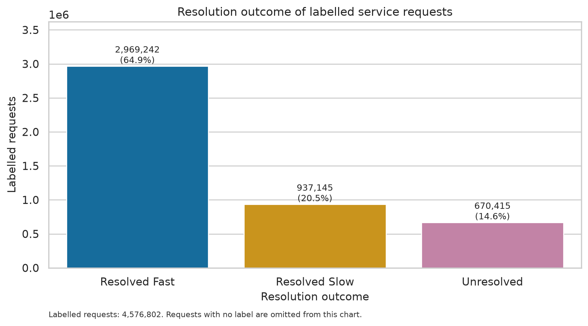

Of the labelled requests, 2,969,242 (64.9%) are Resolved Fast, 937,145 (20.5%) are Resolved Slow, and 670,415 (14.6%) are Unresolved. Another 16,001 rows have no label. Accuracy alone would reward a prediction of Resolved Fast. Macro-F1 is the primary metric because it gives the three classes equal weight.

### Figure 2. Missingness and data quality

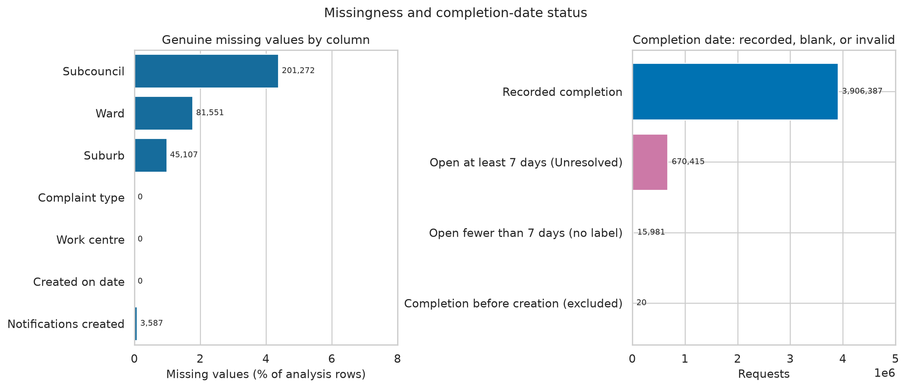

A blank completion date is usually an open request, not a value to impute into a predictor. 670,415 blanks are open requests old enough to be labelled Unresolved. 15,981 blanks are still inside the seven-day window and stay unlabelled. 20 rows have a completion date before the creation date and are excluded. Stored placeholders are larger than several of the genuine gaps. The coordinate flag, which does not store the coordinates, marks 22.55% missing, 54.76% outside the local metre envelope, and 22.69% inside it. No map was drawn. The envelope is not an official coordinate reference system.

### Figure 3. Outcome by work centre

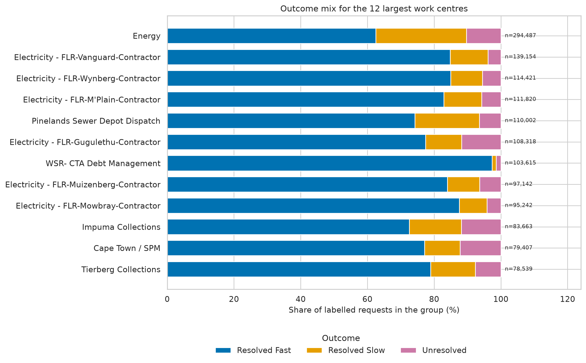

The chart shows the 12 centres with the most labelled requests. They cover 1,415,810 requests, 30.9% of labelled requests. Energy is the largest, with 294,487 labelled requests. The median centre has 45 labelled requests, and 1,216 centres have fewer than 100. Among larger centres, the outcome mix is not uniform: some electricity contractor centres are mostly Resolved Fast, while Revenue Protection East is 98.5% Unresolved among centres with at least 5,000 labelled requests. These differences are descriptive. The extract has no assignment time, so we did not use work centre as a model input.

### Figure 4. Outcome by complaint type

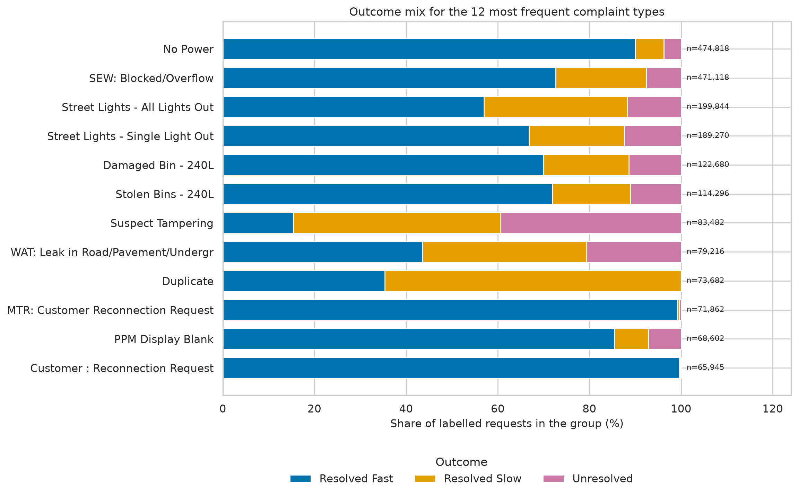

The 12 most common labelled complaint types cover 2,014,815 requests, 44.0% of labelled requests. No Power (474,818 requests) is 90.0% Resolved Fast. SEW: Blocked/Overflow (471,118) is closer to the overall mix. Suspect Tampering is 15.4% Resolved Fast, 45.2% Resolved Slow, and 39.4% Unresolved. Names beginning `DO NOT USE` remain in the extract. Complaint type is a logging-time field and is a model input. Rare names are grouped later, on the training rows only.

### Figure 5. Monthly request volume

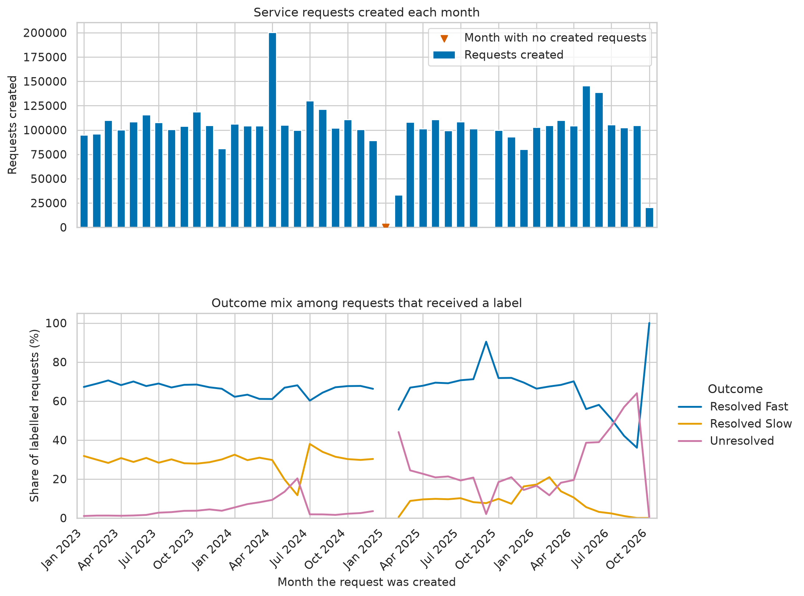

A typical month that contains rows has about 104,427 requests. January 2025 has none. February 2025 has 33,496 and September 2025 has 500. From May 2026 the Unresolved share rises, and September 2026 has no Resolved Slow row. October 2026 is partly inside the observation window, so many of its requests have no label. The late rise in Unresolved is the edge of a frozen extract, which is why rows created after 30 April 2026 are left out of the model splits.

### Figure 6. Resolution duration

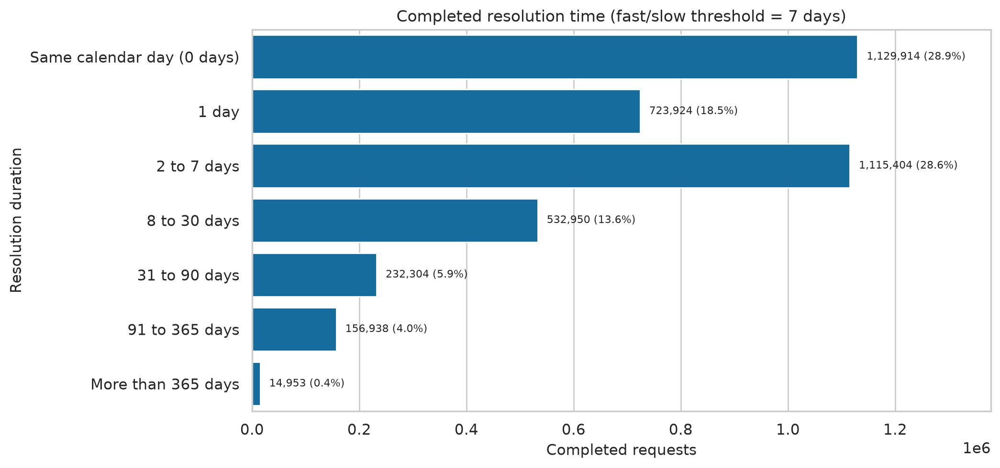

Of 3,906,387 completed requests, 28.9% were closed on the same calendar day. The source stores dates and not times, so a duration of zero can still have taken hours. 76.0% of completions fall within seven days. The median completed duration is 2 days and the 75th percentile is 7 days. The maximum is 1,135 days. 14,953 completions longer than 365 days were kept.

## 4. Target construction

We build the label from Created On Date and Completed Date. It is not a City service standard. The cut is seven calendar days, which matches the 75th percentile of completed durations in this file. The observation window is also seven days. The reference date for the audit is 6 October 2026, the latest created date in the file.

- A completion within seven calendar days is Resolved Fast.
- A longer completion is Resolved Slow, including durations above 365 days.
- A request that is still open, and whose age is at least seven days, is Unresolved.
- An open request younger than seven days is `insufficient_follow_up` and is not labelled. There are 15,981 such rows. They are not treated as failures.
- A completion after the reference date is treated as not yet known, and the same open-request rule is applied.
- Twenty rows have a completion before creation and are excluded.
- Missing or malformed created dates: none in this file.

Completed Date, Changed on, and the derived duration are used to build the label. They are not predictors.

## 5. Cleaning, features, split, and leakage

We kept the long durations and the repeated notification ids that are not exact copies. Placeholder text such as `#`, `GENERIC TOWN 0000`, and `Not assigned` stays as its own category rather than being imputed. We withheld coordinates and notification type before modelling.

Our split is chronological. It does not use the random seed.

| Split | Dates | Labelled rows | Resolved Fast | Resolved Slow | Unresolved |
| --- | --- | --- | --- | --- | --- |
| Train | 2023-01-01 to 2024-12-31 | 2,616,595 | 66.2% | 29.3% | 4.5% |
| Validation | 2025-02-01 to 2025-12-31 | 936,469 | 69.3% | 9.4% | 21.3% |
| Locked test | 2026-01-01 to 2026-04-30 | 422,033 | 68.0% | 15.5% | 16.4% |

The validation window starts on 1 January 2025. January 2025 has no rows. We end the mature window on 30 April 2026 because May 2026 is where the labelled mix breaks. We set that cut from the monthly pattern before the models were fit. We did not choose it to maximise a score. 601,705 labelled rows created after that date are in none of the three splits.

Included predictors: complaint type, suburb, ward, subcouncil, weekday name, month name, and a weekend indicator. Weekday and month are one-hot encoded for the linear and neural models. The weekend indicator is the only numeric predictor. Its scaler is fit on the training rows.

Excluded: Work Center, because the extract has no assignment time; the raw Created On Date; Completed Date; Changed on; resolution duration; the target; notification identifiers; and coordinates.

For one-hot models, a training category is kept when it has at least 200 training rows. Rarer categories and categories first seen later become `(rare)`. Missing categorical values become `(missing)`. The encoded training matrix has 2,616,595 rows and 1,718 columns, with 18,316,165 stored values. A dense float32 copy would be 16.7 GiB, so logistic regression and the multilayer perceptron use the sparse matrix.

Histogram gradient boosting uses native categorical codes. The booster accepts at most 255 categories, so the tree encoder keeps at most 253 training levels plus missing and rare. Suburb and complaint type each keep 253 levels. An unseen category uses the trained rare code when that code exists.

We handle class imbalance with balanced weights from the training counts: Resolved Fast 0.504, Resolved Slow 1.137, Unresolved 7.372. Validation and test rows are not resampled. We do not use SMOTE, because the predictors are categories and SMOTE would invent levels that were not logged.

## 6. Dummy baseline and traditional models

The most-frequent dummy predicts the majority training class, Resolved Fast. On the validation period its accuracy is 0.693 and its macro-F1 is 0.273. On the locked test its accuracy is 0.680 and its macro-F1 is 0.270. Recall is 1 for Resolved Fast and 0 for the other two classes. That is the floor a useful model has to clear on macro-F1.

Logistic regression uses saga, C = 1, L2, balanced class weights, max_iter 200, tolerance 0.001, and seed 42. Fit time was 247.9 seconds. The solver stopped at the iteration cap with a convergence warning. The one-hot columns are 0/1 and the weekend indicator is standardised on the training rows, so the warning is the iteration budget on 2,616,595 sparse rows, not a missing numeric scaler. A later refit with the same settings and max_iter 1000 also stopped at the cap, still with a convergence warning, and its validation macro-F1 was 0.453. We did not adopt that run. Two further checks kept max_iter 200 and the same C, tolerance, solver, and class weights. Removing the intercept left the warning in place and scored validation macro-F1 0.467. Variance-scaling the one-hot block, while leaving the already standardised weekend column unchanged, also stopped at iteration 200 with a warning and scored validation macro-F1 0.465. We adopted neither variant. The reported logistic scores remain the 200-iteration fit with an intercept: validation accuracy 0.578, macro-F1 0.460, and weighted-F1 0.630. The details are in `results/tables/11_logistic_convergence.json` and `results/tables/12_logistic_conditioning.json`. Locked-test scores from notebook 03 are accuracy 0.577, macro-F1 0.467, and weighted-F1 0.610.

Those saved scores are comparable with the other models because they use the same labels, the same chronological split, and the same metric functions. They are the scores of a fit that stopped at the iteration cap. They are not the scores of a solution that met the tolerance. `results/tables/11_logistic_convergence.json` records `converged` as false and `convergence_warning` as true. The 1000-iteration check is a different fit, with validation macro-F1 0.453, and we do not mix it into the comparison table. On 18 October 2026 we refit the same 200-iteration settings on the training period for the common ROC figure. That refit raised `ConvergenceWarning` and reproduced the saved validation macro-F1 of 0.460268 within 0.0001 before we kept its locked-test curve. We retain the warning. We do not describe the logistic model as having converged.

Locked-test recall for that same 200-iteration fit is 0.672 for Resolved Fast, 0.454 for Resolved Slow, and 0.303 for Unresolved. Resolved Slow precision is 0.202. The 1000-iteration refit did not score the locked test.

Histogram gradient boosting, in the Phase 5 configuration, uses log loss, learning rate 0.1, at most 31 leaves, minimum 50 samples per leaf, L2 regularisation 1, and balanced weights. Early stopping watches validation macro-F1. Fit time was 17.9 seconds. It trained 8 iterations and the predictions use iteration 2. Validation macro-F1 at that iteration is 0.482. Accuracy is 0.591, weighted-F1 is 0.640, Resolved Slow recall is 0.416, and Unresolved recall is 0.492. Macro ROC-AUC is 0.739 and macro average precision is 0.506.

We did not fit a dense random forest on the one-hot matrix.

## 7. Neural networks

The multilayer perceptron reads the training-only one-hot pipeline. The architecture is 1,718 inputs, hidden widths 128 and 64, and 3 logits. Activation is ReLU. Dropout is 0.3. The optimiser is AdamW with learning rate 0.001 and weight decay 0.0001. Batch size is 8,192. The loss is class-weighted cross-entropy. The maximum is 8 epochs, with patience 3 on validation macro-F1. The network has 228,483 parameters. It ran 6 epochs, restored epoch 3, and stopped early. Fit time was 329.5 seconds.

Validation scores: accuracy 0.601, macro-F1 0.476, weighted-F1 0.647, Resolved Slow recall 0.452, Unresolved recall 0.394, macro ROC-AUC 0.739, macro average precision 0.508.

Our learning curve is `results/figures/05_mlp_learning_curves.png`. Training loss fell from 0.638 at epoch 1 to 0.553 at epoch 6. Validation loss rose from 1.461 to 1.993. Validation macro-F1 peaked at 0.476 on epoch 3. The training curve is computed with dropout turned off so it can be compared with the validation curve.

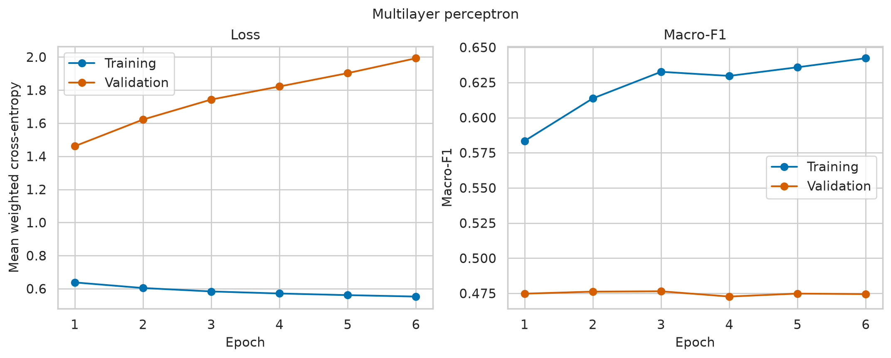

Our second network embeds each categorical field. Embedding dimension is 16, the hidden layer has 64 units, and dropout is 0.3. The optimiser, batch size, loss, and early-stopping rule match the perceptron. Unseen categories use index 0, and that embedding row stays at zero. Work centre is not an input. It ran 7 epochs and restored epoch 4. Fit time was 236.2 seconds. Validation macro-F1 is 0.481. Lecturer approval has been recorded for this architecture. No approval date was supplied, and we did not change the architecture. The validation comparison includes it. Histogram gradient boosting remains ahead, at 0.482, so the embedding network does not become the champion. We did not use the locked test for that decision. Its curve is `results/figures/10_embedding_learning_curves.png`. We redrew `results/figures/05_embedding_learning_curves.png` from the same saved history and use the same approved title. This report uses the corrected figure. Training loss fell while validation loss rose, as it did for the perceptron.

## 8. Evaluation and model comparison

Macro-F1 is the primary metric. Accuracy, weighted-F1, and recall for Resolved Slow and Unresolved are reported with it. Where the model implements `predict_proba`, macro one-versus-rest ROC-AUC and macro average precision are reported. Section 14 adds the per-class ROC and precision-recall curves for the frozen champion, and one locked-test ROC figure for every required model. The earlier macro summaries were kept.

Phase 5 validation comparison, approved models only:

| Model | Accuracy | Macro-F1 | Weighted-F1 | Slow recall | Unresolved recall | ROC-AUC | PR-AUC |
| --- | --- | --- | --- | --- | --- | --- | --- |
| Histogram gradient boosting | 0.591 | 0.482 | 0.640 | 0.416 | 0.492 | 0.739 | 0.506 |
| Embedding network | 0.592 | 0.481 | 0.642 | 0.435 | 0.462 | 0.741 | 0.513 |
| Multilayer perceptron | 0.601 | 0.476 | 0.647 | 0.452 | 0.394 | 0.739 | 0.508 |
| Logistic regression | 0.578 | 0.460 | 0.630 | 0.460 | 0.367 | 0.729 | 0.496 |
| Most-frequent dummy | 0.693 | 0.273 | 0.567 | 0.000 | 0.000 | not computed | not computed |

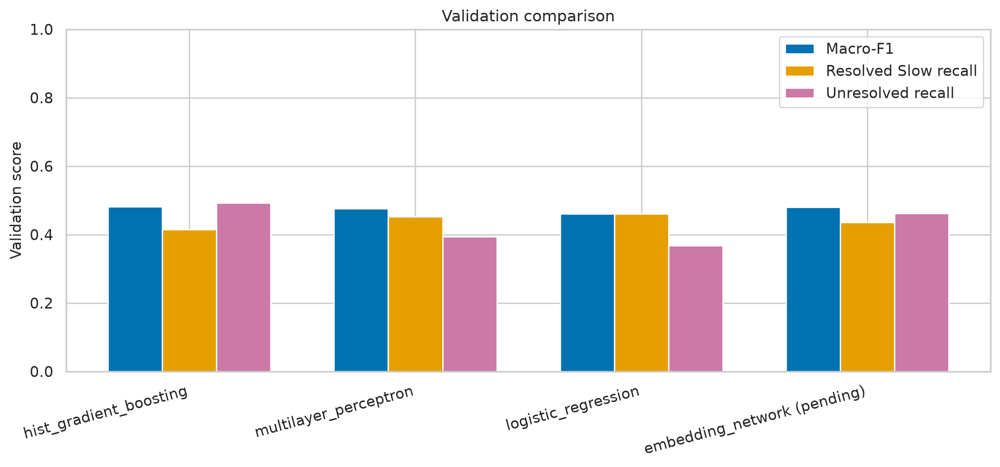

The dummy has the highest accuracy and the lowest macro-F1. It is the naïve baseline and is not one of the four substantive models. Logistic regression has the highest Resolved Slow recall. Boosting has the highest macro-F1 and the highest Unresolved recall. The approved embedding network is second on macro-F1, at 0.481.

We scored the locked test for the dummy and logistic regression in notebook 03. We did not score it in Phase 5. After the Phase 6 freeze we scored it once more, for the frozen booster and for the multilayer perceptron. Those later scores are in section 10. Confusion matrices for the Phase 5 validation fits are in `results/figures/05_confusion_*_validation.png`.

## 9. Overfitting diagnosis and controls

Training macro-F1 is higher than validation macro-F1 for every fitted model in Phase 5.

| Model | Training macro-F1 | Validation macro-F1 | Gap |
| --- | --- | --- | --- |
| Histogram gradient boosting | 0.573 | 0.482 | +0.091 |
| Multilayer perceptron | 0.633 | 0.476 | +0.156 |
| Logistic regression | 0.578 | 0.460 | +0.118 |
| Embedding network | 0.586 | 0.481 | +0.105 |

The perceptron gap is the largest. Its validation loss rose while training loss fell, which is the overfitting pattern the early-stopping rule was there to limit. The restored epoch is the one with the highest validation macro-F1, not the last epoch.

The boosting validation curve peaks at iteration 2 (macro-F1 0.482) after a first iteration at 0.474. Iterations 3 to 8 stay near 0.474 to 0.477. The per-iteration training score in that file is the library's 10,000-row subset, so the training macro-F1 in the table above is the one computed on the full training period. The curve is `results/figures/05_boosting_validation_curve.png`.

The controls we used are a chronological split, encoders and the scaler fit on the training period only, rare-category grouping, dropout and weight decay on the neural nets, L2 on the booster and the logistic model, early stopping on validation macro-F1, and a refusal to resample the validation or test rows. Logistic regression did not reach its tolerance, so its fit is stopped by the iteration cap rather than by a converged solution. We selected the Phase 5 boosting iteration with the 2025 validation scores. Phase 6 does not repeat that selection. The frozen iteration cap comes from the training folds.

## 10. Hyperparameter optimisation and champion selection

Our Phase 5 provisional champion is histogram gradient boosting, because its validation macro-F1 is the highest among the approved models. Lecturer approval of the embedding network has been recorded, so we now include that model. Its validation macro-F1 is 0.481, below histogram gradient boosting at 0.482. We did not use the locked test as an input. The frozen boosting pipeline remains the model we deliver.

We fitted the saved checkpoint `models/embedding_network.pt`, with the training-only encoder `models/embedding_encoder.joblib`, using the same architecture, seed, and split. It reproduced the recorded validation macro-F1 of 0.480687 and the same per-class precision, recall, and F1. On the 2025 validation period those class scores are Resolved Fast 0.882 / 0.654 / 0.751, Resolved Slow 0.145 / 0.435 / 0.217, and Unresolved 0.485 / 0.462 / 0.474. Training macro-F1 is 0.586. Training loss fell and validation loss rose, which is why early stopping restored epoch 4 of 7. That saved fit is the same result, not a second vote. The frozen boosting validation macro-F1 is 0.477. The family comparison uses the Phase 5 boosting score of 0.482, which remains higher, so we do not replace the frozen pipeline.

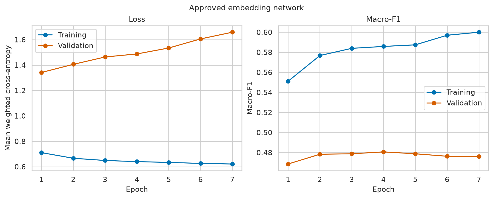

The assignment brief, `reports/IDA117V_Project_Template.pdf`, says to optimise only the strongest validation model. That model is histogram gradient boosting. Logistic regression, the multilayer perceptron, and the embedding network keep the settings fixed before they were fit. Phase 6 tunes only the boosting family. The search space is learning rate {0.05, 0.1, 0.2}, maximum leaves {15, 31, 63}, minimum samples per leaf {50, 200, 500}, and L2 {0.1, 1.0, 10.0}. Eight draws come from `ParameterSampler` with seed 42. Trial 0 is the untuned Phase 5 setting. Each trial is scored on three expanding folds inside the training period:

- train through 30 June 2023, score the rest of 2023
- train through 31 December 2023, score the first half of 2024
- train through 30 June 2024, score the rest of 2024

The trial score is the mean macro-F1. Early stopping inside a fold uses that fold's later slice. Trial 5, learning rate 0.2, 15 leaves, minimum 50 samples, L2 0.1, has the highest mean, 0.544, and a median selected iteration of 4. The untuned setting has mean 0.540 and median iteration 12.

We then refit both settings on all training rows with early stopping off and the iteration cap set to that median. On the 2025 validation period the untuned refit scores macro-F1 0.477 and the tuned refit scores 0.470. The pre-specified rule keeps the tuned refit only when its validation macro-F1 is higher. The frozen candidate is the untuned setting: learning rate 0.1, 31 leaves, minimum 50 samples per leaf, L2 1, 12 iterations, balanced class weights. We wrote that decision to `results/tables/06_frozen_decision.json` before we opened the locked test.

The Phase 5 validation macro-F1 of 0.482 is not the same number. That fit chose iteration 2 on the 2025 curve. The frozen refit does not look at 2025 while it chooses the iteration count.

We scored the frozen model once on the locked test and did not change it afterwards.

| | Accuracy | Macro-F1 | Weighted-F1 | Slow recall | Unresolved recall | ROC-AUC | PR-AUC |
| --- | --- | --- | --- | --- | --- | --- | --- |
| Frozen booster | 0.600 | 0.494 | 0.629 | 0.400 | 0.418 | 0.724 | 0.519 |
| Embedding network | 0.588 | 0.496 | 0.621 | 0.429 | 0.442 | 0.727 | 0.528 |
| Multilayer perceptron | 0.606 | 0.495 | 0.634 | 0.458 | 0.345 | 0.731 | 0.529 |

Locked-test precision for the frozen booster is 0.829 for Resolved Fast, 0.210 for Resolved Slow, and 0.495 for Unresolved. Support is 287,131, 65,522, and 69,380. The low Resolved Slow precision means most requests predicted as slow are not slow.

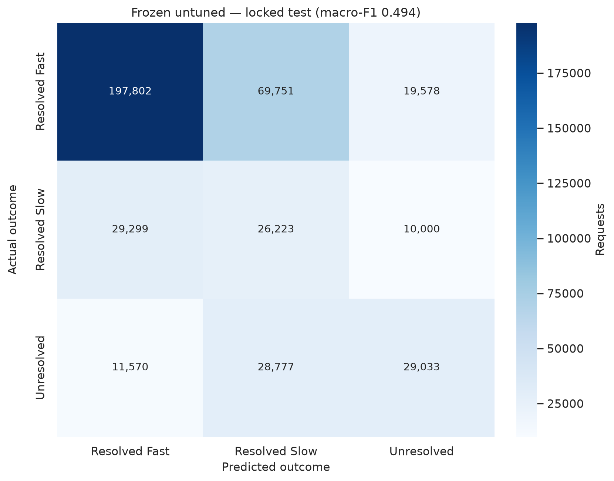

The embedding-network row uses the saved checkpoint on these same locked-test rows. It is the Question 6.2 comparator in section 12. We did not use it to choose the champion. The perceptron row is the historical supplementary comparison. We retrained the perceptron with the Phase 5 procedure before its test score. Its retrained validation macro-F1 is 0.476, the same value as Phase 5. Its locked-test confusion matrix is `results/figures/07_confusion_comparator_locked_test.png`.

## 11. Ablation experiments

Our ablations use the frozen hyperparameters, the same chronological split, and the 2025 validation period. We did not score them on the locked test. One component changes at a time. The reference macro-F1 is 0.477.

| Experiment | Fit? | Macro-F1 | Change | Slow recall | Change | Unresolved recall | Change |
| --- | --- | --- | --- | --- | --- | --- | --- |
| Remove suburb, ward, and subcouncil | Yes | 0.469 | −0.008 | 0.434 | +0.002 | 0.475 | +0.033 |
| Remove work centre | No second model | 0.477 | 0 | 0.432 | 0 | 0.442 | 0 |
| No class weight | Yes | 0.376 | −0.101 | 0.344 | −0.089 | 0.037 | −0.405 |

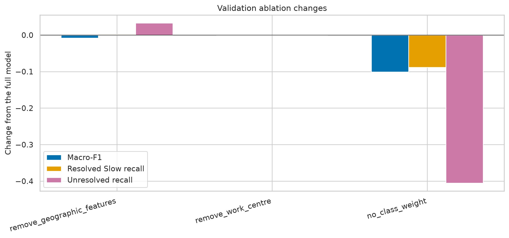

Removing the geographic fields changes macro-F1 by less than one percentage point. Unresolved recall rises by 0.033. The geographic fields are not useless on every class, and they are also not the main source of the macro-F1 score in this comparison.

Work centre was already absent from the champion, because the extract has no assignment time. The `remove_work_centre` row therefore does not change the inputs. We did not fit a second model for that row. The zero change is by construction. That row, on its own, is not a work-centre ablation.

Turning class weights off, with no SMOTE and no other resampling, drops Unresolved recall from 0.442 to 0.037. Unresolved is 4.5% of the training rows, so an unweighted model can score well on the majority class and miss that class. The balanced weights are doing the work this project asked for on Unresolved recall.

### Work-centre sensitivity comparison

In a later comparison we fitted two models. Both use the frozen hyperparameters, seed 42, the training period for the fit, and the 2025 validation period for the score. We did not score the locked test. One model uses the champion features. The other adds `Work_Center` and nothing else. The model without work centre reproduced the saved champion validation macro-F1 of 0.477, with a difference of 0. The settings and the full-precision scores are in `results/tables/09_work_centre_config.json`, `results/tables/09_work_centre_comparison.csv`, and `results/tables/09_work_centre_per_class.csv`.

| Setting | Accuracy | Macro-F1 | Weighted-F1 | ROC-AUC | PR-AUC |
| --- | --- | --- | --- | --- | --- |
| Without work centre | 0.591 | 0.477 | 0.641 | 0.742 | 0.510 |
| With work centre | 0.648 | 0.525 | 0.691 | 0.788 | 0.560 |

| Setting | Fast precision / recall / F1 | Slow precision / recall / F1 | Unresolved precision / recall / F1 |
| --- | --- | --- | --- |
| Without work centre | 0.881 / 0.659 / 0.754 | 0.142 / 0.432 / 0.214 | 0.483 / 0.442 / 0.462 |
| With work centre | 0.895 / 0.727 / 0.803 | 0.168 / 0.486 / 0.249 | 0.603 / 0.464 / 0.524 |

Validation support is 648,570 Resolved Fast, 88,411 Resolved Slow, and 199,488 Unresolved. Adding work centre raises validation macro-F1 by 0.049. We did not replace the champion file. The extract still has no assignment timestamp, so this column is not known to be available when a request is logged. The higher score is a sensitivity result. It is not a logging-time model, and it is not a reason to collect work centre on the form.

## 12. McNemar's test

In Question 6.2 we compare the frozen histogram gradient boosting champion with the approved embedding network. We score both on the same 422,033 locked-test cases. The comparator is the strongest approved model other than the champion by Phase 5 validation macro-F1: histogram gradient boosting 0.481660, embedding network 0.480687, multilayer perceptron 0.476466. Ties would break on Unresolved recall, then Resolved Slow recall, then model name. We did not use the locked test to choose the champion or this comparator.

We take the embedding predictions from the saved checkpoint `models/embedding_network.pt` and the encoder `models/embedding_encoder.joblib`. The encoder was fit on the training period. We did not train the network again, and we did not train it on the locked test. Before we scored those test rows, we applied the same checkpoint to the 2025 validation period. The recomputed validation macro-F1 is 0.480687, the same value as the saved Phase 5 table. The prediction file is `results/tables/13_embedding_locked_test_predictions.parquet`. Its `source_index` order and ground-truth labels match `results/tables/06_test_predictions.parquet` and the chronological test split. The split identifier is `chronological|train_end=2024-12-31|validation_end=2025-12-31|test_end=2026-04-30|seed=42`. The file has no notification identifiers and no coordinates.

Hypotheses, two-sided, alpha 0.05:

- Null: the two models have the same probability of being correct on a locked-test case.
- Alternative: those probabilities differ.

| Both correct | Champion only | Embedding only | Both wrong | Discordant |
| --- | --- | --- | --- | --- |
| 229,320 | 23,738 | 18,625 | 150,350 | 42,363 |

The discordant count is above 25, so the continuity-corrected chi-square approximation is the method that the code uses. The exact binomial test is reserved for fewer than 25 discordant cases. The statistic is (|23738 − 18625| − 1)² / 42363 = 616.8719. The p-value is 3.582e-136. That is below 0.05, so the paired error rates differ. The champion is correct on 5,113 more of the discordant cases.

The test compares paired error rates. It does not show that one model is better on every class, and we did not use it to replace the champion. On this test set the champion's accuracy is 0.600 and its macro-F1 is 0.494. The embedding network's accuracy is 0.588 and its macro-F1 is 0.496. The gaps, champion minus embedding network, are +0.012 in accuracy and −0.002 in macro-F1. Embedding Resolved Slow recall is 0.429 against the champion's 0.400. Embedding Unresolved recall is 0.442 against 0.418. A small macro-F1 gap can still have a very small p-value when the test set has 422,033 rows. The record, including the model names, the row count, the split identifier, and this interpretation, is `results/tables/13_question62_record.json`.

### Historical supplementary comparison

An earlier paired test used the multilayer perceptron. We keep that result, and it is not the Question 6.2 comparison. We retrained the perceptron with the Phase 5 procedure. Its retrained validation macro-F1 is 0.476. On the same 422,033 rows the counts are 233,776 both correct, 19,282 champion only, 21,854 perceptron only, and 147,121 both wrong. The continuity-corrected statistic is 160.6875 and the p-value is 8.006e-37. The practical gaps, champion minus perceptron, are −0.006 in accuracy and −0.001 in macro-F1. The perceptron has higher Resolved Slow recall (0.458 against 0.400) and lower Unresolved recall (0.345 against 0.418). Those files are `results/tables/07_mcnemar_test.csv` and `results/tables/07_paired_predictions.parquet`. The frozen-decision file still names the perceptron in the comparator field that notebook 07 originally read. We did not rewrite that historical field.

## 13. Prediction interface

`streamlit run app/app.py` loads `models/frozen_resolution_pipeline.joblib`. The application does not fit a model and does not rebuild the encoder. In notebook 08 we check that file and do not refit it. When we compared the export with the notebook 06 predictions, 422,033 of 422,033 labels matched.

The form asks for complaint type, suburb, ward, subcouncil, and the creation date. Dropdown values are categories kept from the training period. The date is used only to derive the weekday, the month, and the weekend flag. Work centre is not requested. Unknown categories are grouped with rare or unseen levels. Missing fields and dates outside 1 January 2023 to 6 October 2026 are rejected.

We treat the estimate as an academic prototype and not as an official City of Cape Town system. A prediction must support human review and must not be used to deny or reduce service. The result caption describes the three probabilities as model confidence under balanced class weights, not as causes and not as the historical share of each class.

The demonstration checklist is `reports/demonstration_checklist.md`. We ran eight cases on the saved pipeline. On 17 October 2026 we captured the running page into `evidence/screenshots/`. The blank form, the filled demonstration sample, the estimate, and the empty-form validation message are separate files. The capture notes are in `evidence/README.md`. The sample shown on the page is No Power, PHILIPPI, ward 000, Sub-Council 16, and 12 June 2024. The page estimated Resolved Fast, with predicted probabilities 0.598, 0.247, and 0.154. We scored a second assembled input, using other frequent categories, as Unresolved in the checklist. That row is not a logged municipal case.

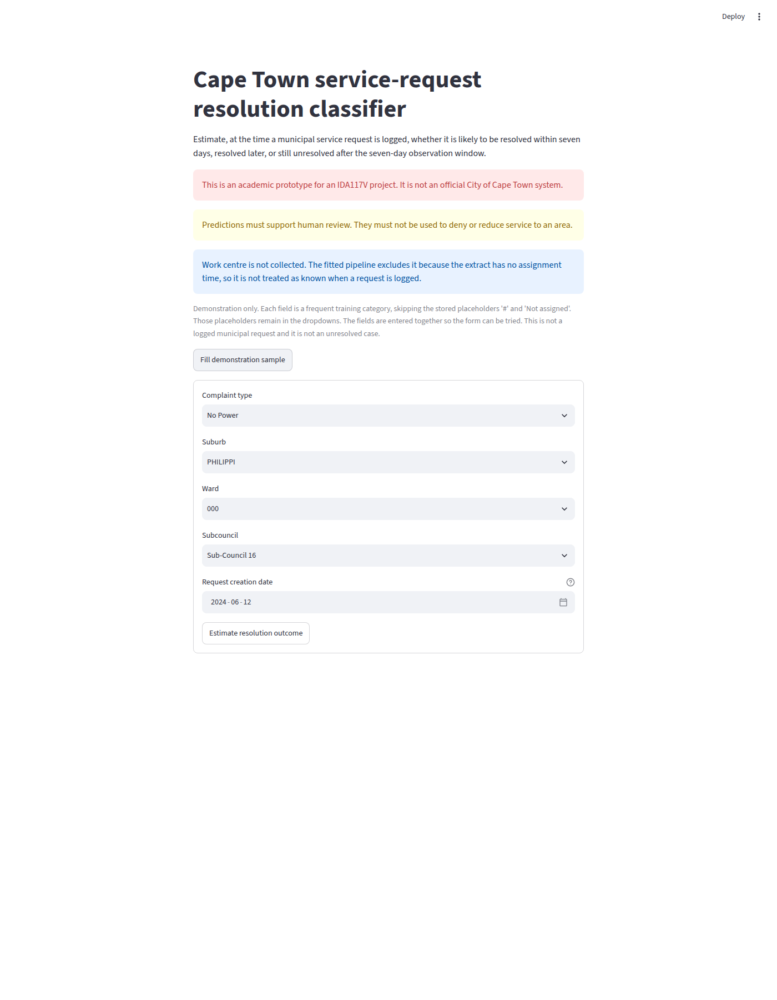

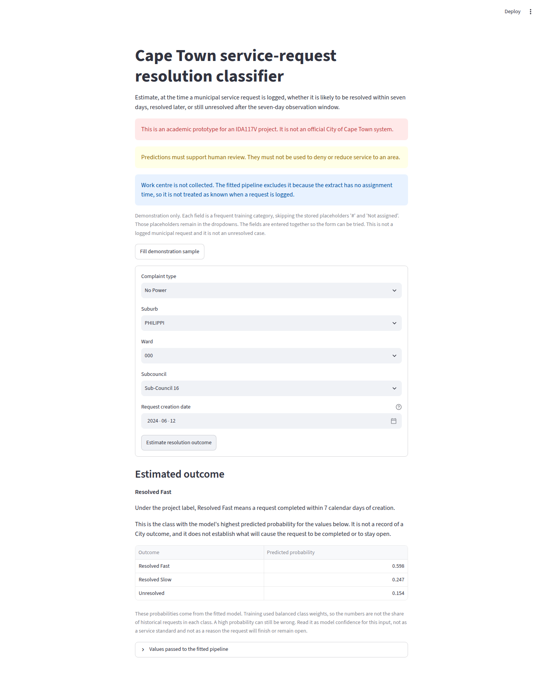

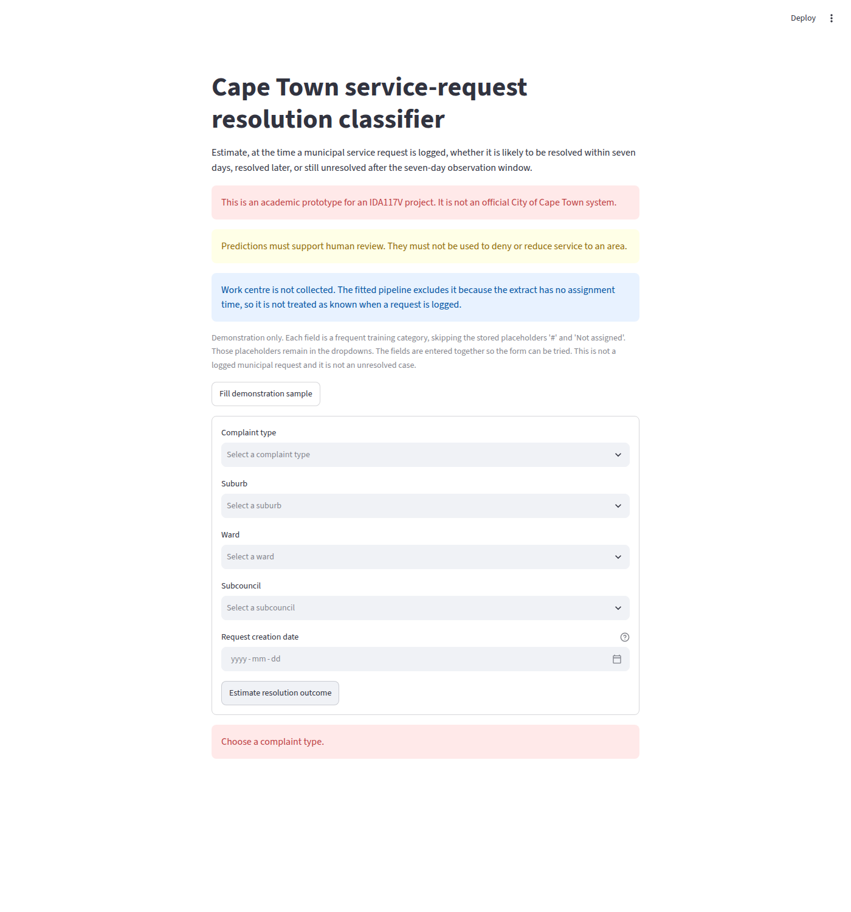

## 14. Per-class ROC and precision-recall curves

Our curves use the frozen champion's locked-test probabilities in `results/tables/06_test_predictions.parquet`. They are one-versus-rest curves from those probabilities, not from the hard class labels. We recomputed the saved macro ROC-AUC of 0.724 and macro average precision of 0.519 in `results/tables/06_locked_test_summary.csv` from the same file, and the values matched. We did not overwrite that summary file.

| Class | Support | ROC-AUC | Average precision |
| --- | --- | --- | --- |
| Resolved Fast | 287,131 | 0.763 | 0.854 |
| Resolved Slow | 65,522 | 0.613 | 0.216 |
| Unresolved | 69,380 | 0.796 | 0.487 |

Resolved Slow is the weak ranking class. Its average precision is 0.216, close to its share of the locked test, and its ROC-AUC is 0.613. The full-precision table is `results/tables/09_per_class_ranking_locked_test.csv`.

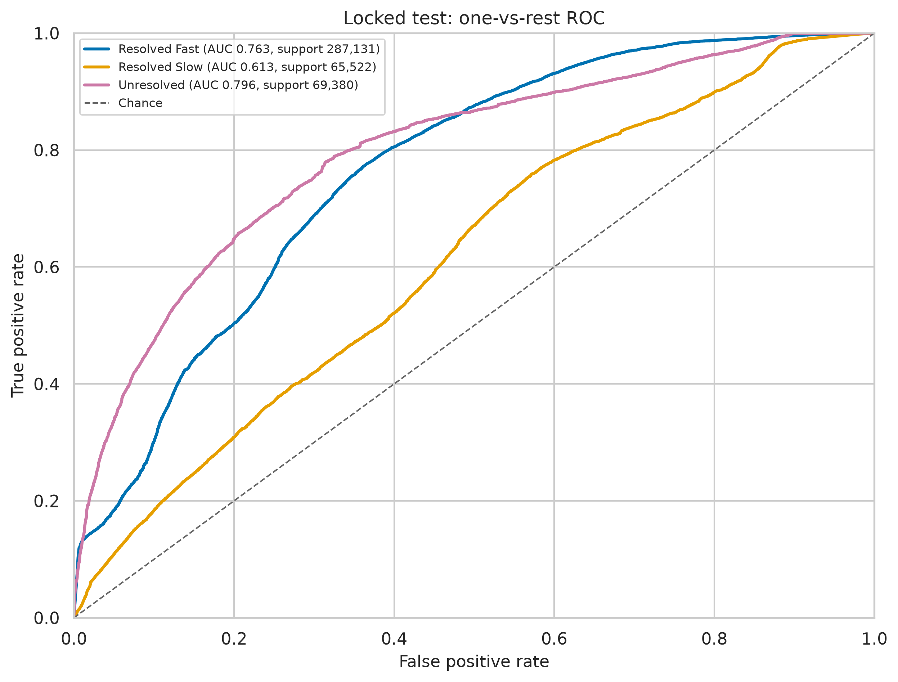

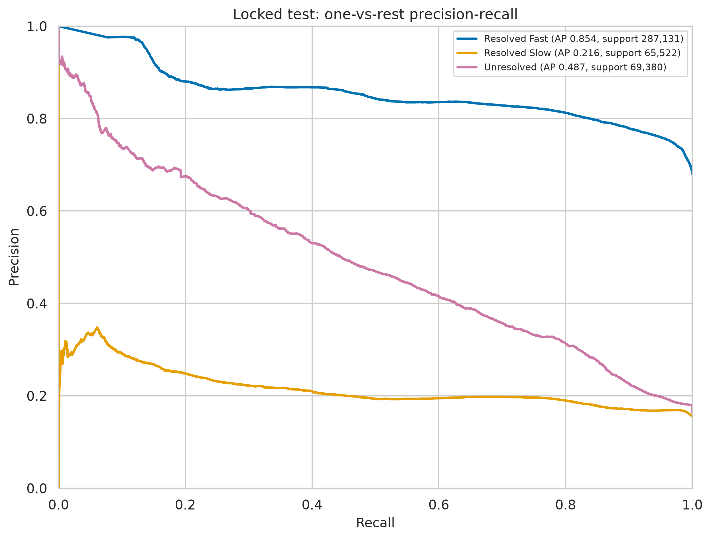

### One figure for every required model

The assignment asks for one ROC figure covering the required models. The required set used here is the most-frequent dummy, logistic regression, histogram gradient boosting, the multilayer perceptron, and the approved embedding network. Each curve is the macro average of the three one-versus-rest curves, drawn on the same 422,033 locked-test rows. A class curve is omitted only when that class has no positive rows or is the only class present. All three classes are present, so every model has three class curves. The class AUCs and the macro and micro averages are in `results/tables/13_roc_all_models_locked_test.csv`.

Champion probabilities are the saved columns in `results/tables/06_test_predictions.parquet`. Embedding probabilities are the checkpoint scores from section 12. We refit the dummy, logistic regression, and the perceptron on the training period only. Each refit had to reproduce its saved validation macro-F1 within 0.0001 before we kept its locked-test scores. The logistic refit also had to raise the same non-convergence warning as the reported baseline. All three passed. We omitted no curve, and we did not use these scores to change the champion.

| Model | Fast AUC | Slow AUC | Unresolved AUC | Macro AUC | Micro AUC |
| --- | --- | --- | --- | --- | --- |
| Most-frequent dummy | 0.500 | 0.500 | 0.500 | 0.500 | 0.760 |
| Logistic regression | 0.763 | 0.608 | 0.791 | 0.721 | 0.786 |
| Histogram gradient boosting | 0.763 | 0.613 | 0.796 | 0.724 | 0.789 |
| Embedding network | 0.764 | 0.615 | 0.803 | 0.727 | 0.788 |
| Multilayer perceptron | 0.773 | 0.624 | 0.796 | 0.731 | 0.800 |

The champion's class AUCs match the table above them. The dummy assigns the same class probabilities to every row, so each one-versus-rest AUC is 0.500 and its curve lies on the diagonal. Its micro AUC is higher because the micro average pools the three score columns, and those columns are not the same constant. That micro value is not a ranking result. Logistic regression remains the non-converged fit. The perceptron has the highest macro AUC on this figure, 0.731. That is a locked-test description. The champion remains the frozen booster chosen on validation macro-F1.

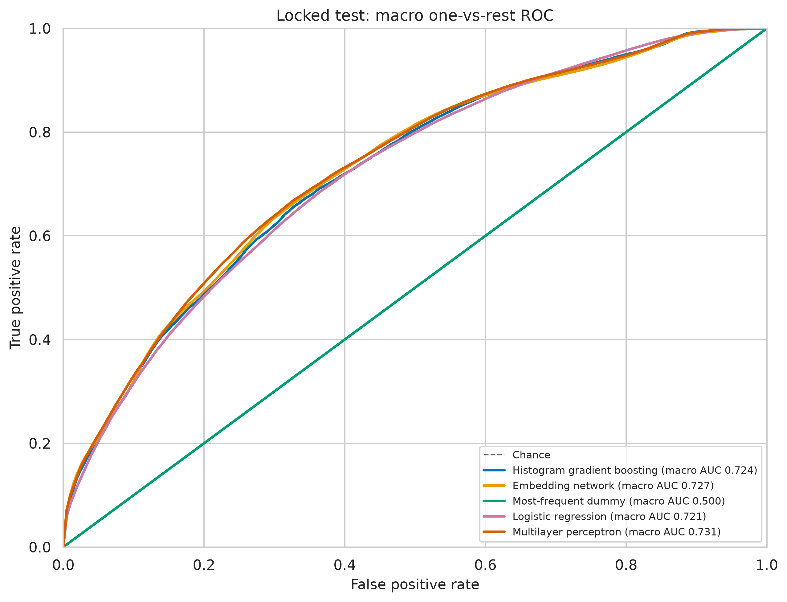

## 15. Suburb and ward error audit

Our audit uses the same locked-test predictions, joined to suburb and ward by the saved row index. It does not fit a model, and it does not contain notification ids or row-level records. A group needs at least 200 test rows before we report any class metric, and that class needs at least 30 actual rows in the group. We count and flag smaller groups. They are not evidence of geographic bias.

The locked test has 422,033 rows, 7,806 suburb values, and 119 ward values. Class metrics are reported for 359 suburbs. The other 7,447 suburbs hold 61,698 rows. Class metrics are reported for 115 wards. The other 4 wards hold 467 rows.

Stored codes that are not a named place are kept as their own groups. Suburb `#` has 34,305 rows and a blank suburb has 1,666. Ward `#` has 177,319 rows, ward `000` has 33,272, and a blank ward has 2,490. Those codes are data-quality groups.

Among suburbs with at least 200 rows, the error rate runs from 0.217 to 0.678. Among wards with at least 200 rows, it runs from 0.066 to 0.771. Complaint type is not held constant, so that range is not a finding that one area is treated unfairly. In 296 of the 359 large suburbs, and in 100 of the 115 large wards, the most common mistake is Resolved Fast predicted as Resolved Slow. That repeats the champion's weak Resolved Slow precision. It is not a separate geographic result.

PHILIPPI is one large named suburb, with 9,674 test rows and an error rate of 0.356. Its reported class metrics are Resolved Fast precision 0.842, recall 0.742, and F1 0.789 on 7,015 rows; Resolved Slow precision 0.250, recall 0.525, and F1 0.338 on 1,313 rows; Unresolved precision 0.461, recall 0.253, and F1 0.326 on 1,346 rows. The same table gives the other groups that pass the support rule.

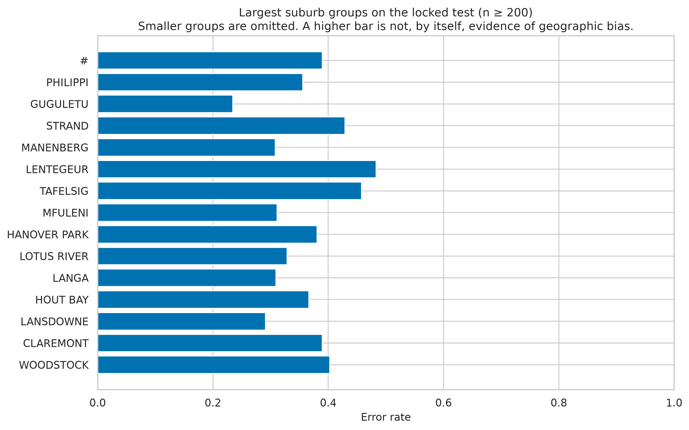

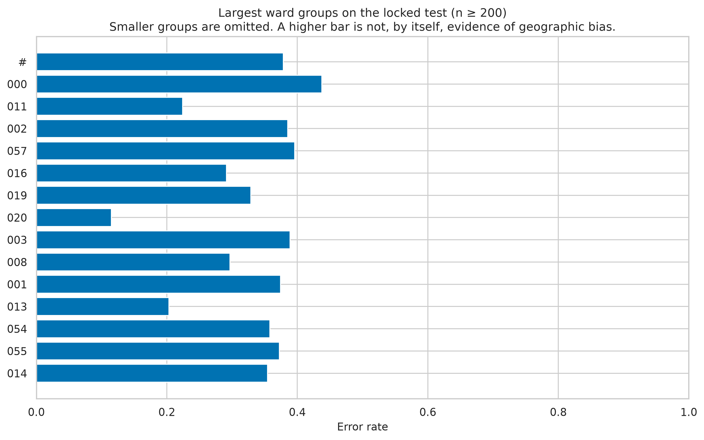

The machine-readable tables are `results/tables/09_suburb_error_audit.csv` and `results/tables/09_ward_error_audit.csv`. The class metrics are `results/tables/09_suburb_class_metrics.csv` and `results/tables/09_ward_class_metrics.csv`. The confusion counts are `results/tables/09_suburb_confusion_counts.csv` and `results/tables/09_ward_confusion_counts.csv`, and they are saved only for groups with at least 200 rows. The support rules are in `results/tables/09_geographic_audit_config.json`.

## 16. Ethics, fairness, limitations, and recommendations

The City terms say the data are provided as is and that reliance is at the user's risk. We do not present this prototype as an official City system. The label is our project rule, not a published service standard. A prediction does not establish why a request will be completed or will stay open.

Resolved Slow precision on the locked test is 0.210. If a department treated "Resolved Slow" as a reason to delay or refuse work, most of those flags would be wrong, and the harm would fall on the people waiting for the service. That is why we treat the model as a review aid, and why a prediction must not be used to delay or refuse work.

Section 15 counts locked-test errors by suburb and by ward. It is not a disparity finding. Suburb `#` is 7.97% of analysis rows, subcouncil `Not assigned` is 35.34%, and ward `000` is a very common stored value. The geographic ablation changes validation macro-F1 by −0.008. We did not report class metrics for groups below 200 test rows, and we did not change the model after the audit.

Other limitations, all from the executed work:

- The layer is frozen. Open requests may have been completed later, so some Unresolved labels can be wrong.
- The 2025 class mix is not the 2023–2024 mix. Unresolved rises from 4.5% to 21.3%.
- Logistic regression did not converge at 200 iterations, at a 1000-iteration check, or in the separate no-intercept and variance-scaled checks. We did not adopt those runs. The reported baseline remains the 200-iteration fit.
- The embedding network is approved and is not the champion. Its recorded validation macro-F1 is 0.481, and histogram gradient boosting is 0.482. No approval date was supplied. Its locked-test score in section 12 is the Question 6.2 comparison. We did not use it to choose the champion.
- We have not conducted a stakeholder interview. The brief does not require one.
- Question 6.2 is our McNemar comparison of the frozen champion and the embedding network. The earlier perceptron table remains a supplementary result.
- The fitted work-centre comparison is not leakage-safe. The extract has no assignment time, and the champion still excludes that column.
- Balanced weights improve Unresolved recall and, on the logistic test score, leave Resolved Slow precision at 0.202.
- Macro ROC-AUC near 0.72 to 0.74 is better than chance and is not a basis for an automated decision. Resolved Slow average precision on the locked test is 0.216.

From these results we recommend that a person stay between the score and any operational action, and that the scores not be used to rank areas for reduced service. If the model is shown to staff, the three probabilities and the seven-day definition should be shown with them, together with the fact that the weights are balanced. We recommend that work centre stay out of the form until an assignment time is known. The embedding network remains an approved experiment and is not the model we deliver. Our champion decision used validation macro-F1 and did not use the locked test.

## 17. Conclusion and future work

Our results indicate that a most-frequent prediction reaches validation macro-F1 0.273. Logistic regression reaches 0.460 and did not converge. The multilayer perceptron reaches 0.476. The approved embedding network reaches 0.481. Histogram gradient boosting reaches 0.482 in the Phase 5 early-stopped fit and remains our champion under that validation rule. A training-fold search did not beat the untuned refit on the 2025 validation macro-F1, so the frozen pipeline keeps those untuned settings with a 12-iteration cap. Its single locked-test macro-F1 is 0.494, its accuracy is 0.600, its Resolved Slow precision is 0.210, and its Unresolved recall is 0.418. Question 6.2 then compares that frozen model with the embedding network on the same locked-test rows. The continuity-corrected statistic is 616.8719 and the p-value is 3.582e-136. The accuracy gap is +0.012 and the macro-F1 gap is −0.002, champion minus embedding network. That difference in paired error rates is not a reason to replace the frozen model after seeing the test.

The use we deliver is a queue aid for a reviewer in the department that receives the request. The three probabilities stay visible. A class label is not an instruction to delay, refuse, or reduce service. Suburb and ward error rates vary, and complaint type is not held constant, so those tables are not a finding that one area should receive less service. Work centre still has no assignment time, so it stays out of the logging-time model even though a validation-only sensitivity fit scored higher.

We did not use the locked test to select or tune the champion, and we did not replace `results/tables/06_test_predictions.parquet`. The Question 6.2 comparison on those same 422,033 rows matches the saved record: 229,320 both correct, 23,738 champion only, 18,625 embedding only, and 150,350 both wrong, with statistic 616.8719 and p-value 3.582e-136. The tables and figures added after the freeze can be reproduced with `src.work_centre_comparison`, `src.geographic_error_audit`, `src.per_class_curves`, `src.embedding_experiment`, and `src.locked_test_comparison`. The last of these reloads the saved embedding checkpoint, checks it on the 2025 validation period, scores the existing locked test once, and writes the Question 6.2 table and the common ROC figure. It also refits the dummy, the non-converged logistic regression, and the multilayer perceptron on the training period when their validation macro-F1 matches the saved value. It does not replace `results/tables/06_test_predictions.parquet` or `results/tables/06_frozen_decision.json`.

We would not reuse the locked test for later tuning. Two extensions that respect that rule are calibration of the probabilities, and a return to work centre only if an assignment timestamp becomes available. We did not conduct a stakeholder interview, and the brief does not require one. Any later operational claim would need one.

## References

University of South Africa (2026) *IDA117V project template, Semester 2 2026*. The copy we read for this report is `reports/IDA117V_Project_Template.pdf`.

City of Cape Town (2026) *Service Requests 2023 until 06 October 2026 (Deprecated)*. SAP C3 Notifications feature layer. City of Cape Town Open Data Portal. Available at: https://odp-cctegis.opendata.arcgis.com/datasets/90711027d33940b5a06e96ad8a8f7ede_0/explore (Accessed: 16 October 2026). Terms read the same day: https://www.capetown.gov.za/general/city-of-cape-town-open-data-terms-of-use/

Republic of South Africa (2013) *Protection of Personal Information Act 4 of 2013*. Pretoria: Government Printer.

Defazio, A., Bach, F. and Lacoste-Julien, S. (2014) ‘SAGA: a fast incremental gradient method with support for non-strongly convex composite objectives’, *Advances in Neural Information Processing Systems*, 27.

Edwards, A.L. (1948) ‘Note on the “correction for continuity” in testing the significance of the difference between correlated proportions’, *Psychometrika*, 13(3), pp. 185–187.

Fawcett, T. (2006) ‘An introduction to ROC analysis’, *Pattern Recognition Letters*, 27(8), pp. 861–874.

Guo, C. and Berkhahn, F. (2016) ‘Entity embeddings of categorical variables’, *arXiv:1604.06737*. The embedding network uses one learned vector per training category. It is not a copy of that paper’s code.

Harris, C.R. et al. (2020) ‘Array programming with NumPy’, *Nature*, 585, pp. 357–362. NumPy 2.5.4.

Hunter, J.D. (2007) ‘Matplotlib: a 2D graphics environment’, *Computing in Science & Engineering*, 9(3), pp. 90–95. Matplotlib 3.11.2.

Loshchilov, I. and Hutter, F. (2019) ‘Decoupled weight decay regularization’, *International Conference on Learning Representations*. The neural fits use `torch.optim.AdamW`.

McKinney, W. (2010) ‘Data structures for statistical computing in Python’, *Proceedings of the 9th Python in Science Conference*, pp. 56–61. pandas 3.0.6.

McNemar, Q. (1947) ‘Note on the sampling error of the difference between correlated proportions or percentages’, *Psychometrika*, 12(2), pp. 153–157.

Paszke, A. et al. (2019) ‘PyTorch: an imperative style, high-performance deep learning library’, *Advances in Neural Information Processing Systems*, 32. The installed build is torch 2.14.1+cpu.

Pedregosa, F. et al. (2011) ‘Scikit-learn: machine learning in Python’, *Journal of Machine Learning Research*, 12, pp. 2825–2830. scikit-learn 1.9.1 supplies the dummy classifier, the saga logistic regression, and histogram gradient boosting.

Streamlit Inc. (2026) *Streamlit*. Version 1.66.0. Available at: https://streamlit.io (Accessed: 18 October 2026).

Virtanen, P. et al. (2020) ‘SciPy 1.0: fundamental algorithms for scientific computing in Python’, *Nature Methods*, 17, pp. 261–272. SciPy 1.18.1 supplies `binomtest` and `chi2` for McNemar’s test.

Waskom, M.L. (2021) ‘seaborn: statistical data visualization’, *Journal of Open Source Software*, 6(60), 3021. seaborn 0.13.2 is used for figure styling.

Joblib 1.6.0 stores the encoder and the frozen pipeline. openpyxl 3.1.5 is the Excel reader named in `src/data_loader.py`. JupyterLab 4.6.4 executed the notebooks. No external code fragment was copied into `src/`.

## AI-assistance disclosure

The assignment brief asks us to label AI-assisted work according to institutional policy. The brief itself does not attach a module declaration form. UNISA’s academic-integrity material requires students to acknowledge AI tools. The Unisa Press *Ethical AI use guidelines* of 29 July 2025 apply to Unisa Press manuscripts. They are not a form in this module, and we do not treat them as a signed assignment declaration. We did not store a prompt log in the repository, so this section does not reconstruct prompts we do not have.

The git history shows the following. On 15 October 2026, four commits by Thabang Mokoena added the initial repository, `README.md`, `LICENSE`, `.gitignore`, `src/.gitkeep`, and `requirements.txt`. The later commits that added the audit, the models, the notebooks, the tests, the tables, the figures, and this report are authored `Cursor Agent <cursoragent@cursor.com>`. Those commits were produced in Cursor cloud-agent sessions. The session that wrote this disclosure identifies its model as Grok 4.7. We do not name the models used in earlier sessions, because those names are not stored on the commits.

We produced the measured scores, contingency counts, and figures cited above with the project code from the City extract. We did not type them in as invented results. The agents wrote and ran that code, drafted the report from the saved tables, and exported the PDF. We remain responsible for the submission. This disclosure is not a signature, and it does not assign a mark.

## Appendix A. Contribution statement

We repeat the contribution statement from `reports/contribution_statement.md` in this appendix. Signature cells contain the member’s typed initials. The upper member table is dated 5–8 October 2026. The contribution rows in the lower half, and the confirmation table, are dated 12–18 October 2026. The speaking outline is not a slide file, not an attendance record, and not a defence result. The presentation window in the brief is 5–17 October 2026. This repository has no evidence that the presentation was given. Presentation preparation and coordination is the preparation task only.

| Printed name | Initials | Student number | Email | Signature | Date |
| --- | --- | --- | --- | --- | --- |
| Mpumelelo Ngozo | MSP | 218409202 | 218409202@tut4life.ac.za | MSP | 5 October 2026 |
| Selowa Tumiso | TS | 218340172 | 218340172@tut4life.ac.za | TS | 6 October 2026 |
| Ualwela Netshidzati | U | 220069117 | 220069117@tut4life.ac.za | U | 7 October 2026 |
| Thabang Mokoena | TG | 240668823 | 240668823@tut4life.ac.za | TG | 8 October 2026 |

The repository records four commits on 15 October 2026 by Thabang Mokoena: the initial repository, `README.md`, the `src` placeholder, and `requirements.txt`. Later commits are authored Cursor Agent. The allocation below is the division the team supplied. It is not inferred from those commits.

| Contribution | Allocation | Signature | Date |
| --- | --- | --- | --- |
| Problem definition and project planning | Thabang Mokoena | TG | 5 October 2026 |
| Data collection, audit and cleaning | Mpumelelo Ngozo | MSP | 6 October 2026 |
| Exploratory data analysis | Thabang Mokoena | TG | 7 October 2026 |
| Preprocessing and feature engineering | Selowa Tumiso | TS | 8 October 2026 |
| Model development and evaluation | Mpumelelo Ngozo | MSP | 12 October 2026 |
| Statistical comparisons and ablation analysis | Selowa Tumiso | TS | 14 October 2026 |
| Streamlit interface and deployment | Thabang Mokoena | TG | 15 October 2026 |
| Technical report and references | Ualwela Netshidzati | U | 16 October 2026 |
| Presentation preparation and coordination | Ualwela Netshidzati | U | 18 October 2026 |

Each person signs only the rows allocated to that person. We did not use the locked-test scores to choose the champion. The embedding-network test score is the Question 6.2 comparison only.

| Confirmation | Printed name | Student number | Signature | Date |
| --- | --- | --- | --- | --- |
| I sign only for the rows allocated to me. | Mpumelelo Ngozo | 218409202 | MSP | 12 October 2026 |
| I sign only for the rows allocated to me. | Selowa Tumiso | 218340172 | TS | 14 October 2026 |
| I sign only for the rows allocated to me. | Ualwela Netshidzati | 220069117 | U | 16 October 2026 |
| I sign only for the rows allocated to me. | Thabang Mokoena | 240668823 | TG | 18 October 2026 |
